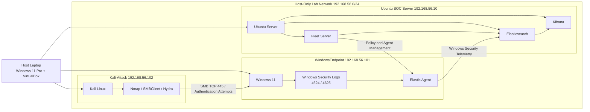

# Lab Architecture & Network Design

## Objective

Build an isolated cybersecurity homelab capable of generating, collecting and analysing Windows security telemetry while safely simulating attacker activity from a separate Kali Linux system.

The environment was designed to support hands-on SOC monitoring, detection engineering and incident investigation using the Elastic Stack.

## Lab Environment

The lab was built in **Oracle VirtualBox** on a Windows 11 Pro host and consists of three virtual machines.

| Virtual Machine | Role | Host-Only IP |
|---|---|---|
| Ubuntu SOC Server | Hosts Elasticsearch, Kibana and Fleet Server | `192.168.56.10` |
| WindowsEndpoint | Monitored Windows 11 endpoint running Elastic Agent | `192.168.56.101` |
| Kali-Attack | Attacker system used for reconnaissance and controlled authentication testing | `192.168.56.102` |

Each virtual machine uses two network adapters:

- **NAT** — provides internet access for updates and package installation.
- **Host-Only Adapter** — provides an isolated `192.168.56.0/24` network for communication between the three lab systems.

## Architecture

