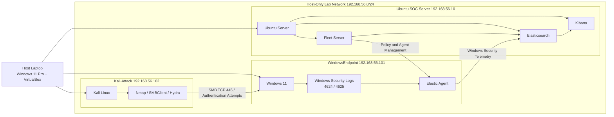

# Lab Architecture & Network Design

## Objective

Build an isolated cybersecurity homelab capable of generating, collecting and analysing Windows security telemetry while safely simulating attacker activity from a separate Kali Linux system.

The environment was designed to support hands-on SOC monitoring, detection engineering and incident investigation using the Elastic Stack.

## Lab Environment

The lab was built in **Oracle VirtualBox** on a Windows 11 Pro host and consists of three virtual machines.

| Virtual Machine | Role | Host-Only IP |
|---|---|---|
| Ubuntu SOC Server | Hosts Elasticsearch, Kibana and Fleet Server | `192.168.56.10` |
| WindowsEndpoint | Monitored Windows 11 endpoint running Elastic Agent | `192.168.56.101` |
| Kali-Attack | Attacker system used for reconnaissance and controlled authentication testing | `192.168.56.102` |

Each virtual machine uses two network adapters:

- **NAT** — provides internet access for updates and package installation.
- **Host-Only Adapter** — provides an isolated `192.168.56.0/24` network for communication between the three lab systems.

## Architecture

## System Roles

### 1. Ubuntu SOC Server — 192.168.56.10

The Ubuntu Server acts as the central security monitoring platform and hosts three core Elastic components:

- **Elasticsearch:** Stores and indexes security telemetry collected from monitored endpoints.
- **Kibana:** Provides an interface for searching logs, creating detection rules, reviewing alerts and conducting security investigations.
- **Fleet Server:** Centrally manages enrolled Elastic Agents and distributes their assigned integration policies.

This server provides the infrastructure required to collect, analyse and investigate security events within the lab.

### 2. WindowsEndpoint — 192.168.56.101

The Windows 11 virtual machine represents a monitored endpoint within an organisation.

Windows generates native security events, including:

- **Event ID 4625:** Failed authentication attempts.
- **Event ID 4624:** Successful authentication attempts.

An Elastic Agent installed on the endpoint collects Windows event logs and forwards them to Elasticsearch. The agent is centrally managed through Fleet.

This allows authentication activity to be monitored and suspicious behaviour to be detected using Elastic Security.

### 3. Kali-Attack — 192.168.56.102

The Kali Linux virtual machine acts as the simulated attacker within the isolated lab environment.

The following tools were used during controlled testing:

- **Nmap:** Network reconnaissance and port discovery.
- **SMBClient:** Remote SMB authentication testing.
- **Hydra:** Controlled password-guessing simulation against a temporary Windows lab account.

The resulting authentication events were collected from WindowsEndpoint and investigated through Elastic Security.

All attack simulations were restricted to the lab environment.

## Network Communication & Security Design

### Network Configuration

The lab uses two VirtualBox network adapters on each virtual machine:

- **NAT:** Provides outbound internet connectivity for operating system updates, software installation and package management.
- **Host-Only Adapter:** Connects the three virtual machines through the private `192.168.56.0/24` network without directly exposing the lab network to external devices.

This design allows the systems to communicate locally while retaining internet access through their separate NAT adapters.

### Security Monitoring Traffic

The WindowsEndpoint generates Windows Security events, which are collected by Elastic Agent and forwarded to Elasticsearch on the Ubuntu SOC Server.

Fleet Server centrally manages the Windows Elastic Agent through assigned integration policies.

Kibana connects to Elasticsearch to provide log searches, detection rules and security alert investigations.

### Firewall Configuration and Controlled SMB Access

During initial reconnaissance, Nmap identified the WindowsEndpoint as reachable but reported the scanned TCP ports as filtered by Windows Defender Firewall.

To enable controlled authentication testing, a temporary inbound firewall rule was created to permit:

- **Protocol:** TCP
- **Destination Port:** 445 (SMB)
- **Source IP:** `192.168.56.102` (Kali-Attack)
- **Destination:** `192.168.56.101` (WindowsEndpoint)

The rule allowed SMB authentication testing without disabling Windows Firewall or broadly opening inbound network access.

Following the attack simulations, the temporary firewall exception and the Hydra test account were removed.

### Security Considerations

The architecture demonstrates several security principles:

- **Network segmentation:** Attack simulations were conducted over a dedicated Host-Only lab network.
- **Least-privilege network access:** SMB access was restricted to a specific source IP and destination port.
- **Centralised logging:** Endpoint security events were collected and stored in Elasticsearch.
- **Controlled testing:** Authentication attacks were directed at a designated lab endpoint using temporary test credentials.
- **Attack-surface reduction:** Temporary network permissions and test accounts were removed after testing.

## Outcome

Successfully deployed a three-VM cybersecurity homelab using Oracle VirtualBox, providing an isolated environment for security monitoring, attack simulation and incident investigation.

### Key Achievements

- Configured three interconnected virtual machines using NAT and Host-Only networking.
- Deployed Elasticsearch, Kibana and Fleet Server on the Ubuntu SOC Server.
- Connected WindowsEndpoint to the Elastic Stack using a Fleet-managed Elastic Agent.
- Established centralised collection of Windows Security events.
- Verified connectivity between the attacker, monitored endpoint and SOC server.
- Validated Windows Firewall restrictions through Nmap reconnaissance.
- Configured restricted SMB access for controlled authentication testing.
- Successfully generated and collected Windows authentication events originating from Kali Linux.
- Removed temporary test credentials and firewall permissions following the simulations.

### Result

The completed network architecture provided the foundation for the SOC monitoring and threat-detection workflows demonstrated in the subsequent project sections.

The environment enabled the investigation of authentication activity across separate attacker, endpoint and monitoring systems while maintaining controlled network access.
